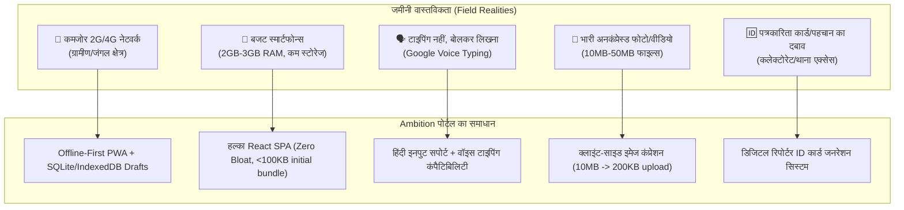

# ⚖️ Ambition News Portal — Compliance & Ground-Level R&D
### छत्तीसगढ़ एवं मध्यप्रदेश डिजिटल मीडिया लीगल अनुपालन एवं जमीनी वास्तविकता

---

## भाग 1: Digital Media Legal Compliance (कानूनी चेकलिस्ट)

भारत में और विशेषकर CG/MP में डिजिटल न्यूज़ पोर्टल चलाने के लिए जरूरी कानूनी आवश्यकताएं:

### 1. IT Rules 2021 (सूचना प्रौद्योगिकी नियम 2021) — अनिवार्य
भारत सरकार के सूचना एवं प्रसारण मंत्रालय (MIB) के अनुसार डिजिटल न्यूज़ पब्लिशर्स के लिए:
- **Grievance Redressal Mechanism (शिकायत निवारण अधिकारी):**
  - वेबसाइट पर एक भारतीय नागरिक का नाम, पद (Grievance Officer), फोन नंबर और ईमेल पता सार्वजनिक होना अनिवार्य है।
  - किसी भी शिकायत (फर्जी खबर, मानहानि, आपत्तिजनक सामग्री) का 24 घंटे में acknowledgment और 15 दिन में समाधान देना कानूनी बाध्यता है।
- **Information Furnishing (MIB को सूचना देना):**
  - MIB के फॉर्म पर अपनी वेबसाइट का विवरण, डोमेन, संपर्क व्यक्ति और कंपनी/संस्था का विवरण जमा करना होता है (Appendix-II under IT Rules 2021)।
- **Three-Tier Redressal:**
  - Level 1: आपका स्वयं का Grievance Officer
  - Level 2: सेल्फ रेगुलेटरी बॉडी (जैसे DIGIPUB या DNPA की सदस्यता - वैकल्पिक पर अनुशंसित)
  - Level 3: केंद्र सरकार की ओवरसाइट मैकेनिज्म।

---

### 2. TRAI DLT Registration (SMS OTP और अलर्ट्स के लिए) — अनिवार्य
- भारत में किसी भी पोर्टल से यूजर/रिपोर्टर को SMS भेजने के लिए टेलीकॉम कंपनियों के DLT (Distributed Ledger Technology) पोर्टल (Jio, Airtel, Vil) पर संस्था का रजिस्ट्रेशन अनिवार्य है।
- **दस्तावेज:** संस्था का PAN, GST/उद्यम रजिस्ट्रेशन, ऑथराइजेशन लेटर।
- **Sender ID (Header):** जैसे `AMBNEW` या `AMBNTN` अप्रूव कराना होगा।
- **SMS Template:** OTP और ब्रेकिंग मैसेज के शब्द पूर्व-स्वीकृत (pre-approved) होने चाहिए।

---

### 3. IPC / Bharatiya Nyaya Sanhita (BNS) & Local Police Risks
स्थानीय स्तर पर (थाना, कलेक्टोरेट) सबसे ज्यादा कानूनी जोखिम रिपोर्टिंग में आते हैं:
- **मानहानि (Defamation):** बिना पुलिस FIR या आधिकारिक पुष्टि के किसी का नाम या फोटो छापने पर स्थानीय नेता/अधिकारी नोटिस भेजते हैं।
  - *समाधान:* पोर्टल पर "Disclaimers", "According to FIR / पुलिस सूत्रों के अनुसार" शब्दावली और दोनों पक्षों का पक्ष (Right of Reply) की व्यवस्था।
- **सांप्रदायिक व संवेदनशील खबरें:** दंगे, जातीय तनाव या धार्मिक विवादों में बिना पुष्टि की रिपोर्टिंग से वेबसाइट ब्लॉक या FIR हो सकती है।
  - *समाधान:* ऐसे मामलों में केवल Editor/Admin स्तर से ही प्रकाशन की व्यवस्था।
- **पोक्सो (POCSO) व जुवेनाइल कानून:** नाबालिग पीड़ित या आरोपी की पहचान, नाम, स्कूल या फोटो दिखाना सख्त गैर-कानूनी (गैर-जमानती अपराध) है।

---

### 4. Copyright & Fact Check Policy
- किसी अन्य समाचार पत्र (दैनिक भास्कर, पत्रिका, नई दुनिया आदि) की पूरी खबर या फोटो कॉपी-पेस्ट करने पर कॉपीराइट नोटिस आ सकता है।
- पोर्टल पर अनिवार्य लीगल पेज:
  1. `Terms of Service` (सेवा की शर्तें)
  2. `Privacy Policy` (गोपनीयता नीति - IT Act Sec 43A)
  3. `Editorial & Correction Policy` (संपादकीय नीति और गलती सुधारने की प्रक्रिया)
  4. `Fact-Checking Policy` (तथ्य जांच नीति)

---

## भाग 2: Ground-Level R&D (जमीनी हकीकत — CG और MP)

छत्तीसगढ़ (बस्तर, सरगुजा, बिलासपुर, रायपुर) और मध्य प्रदेश (बुंदेलखंड, चंबल, मालवा, महाकौशल) के फील्ड रिपोर्टर्स और पाठकों की वास्तविक स्थिति:

---

### 1. फील्ड रिपोर्टर की कार्यशैली और चुनौतियां

| जमीनी समस्या | फील्ड की वास्तविक स्थिति | पोर्टल में तकनीकी समाधान |
|---|---|---|
| **WhatsApp पर निर्भरता** | 95% रिपोर्टर खबर लिखकर WhatsApp ग्रुप में भेजते हैं। भारी ऐप या जटिल CMS वो इस्तेमाल नहीं करते। | फॉर्म एकदम WhatsApp जैसा सरल — सिर्फ 4 फील्ड: जिला, शीर्षक, विवरण, फोटो। |
| **टाइपिंग में परेशानी** | ग्रामीण रिपोर्टर कीबोर्ड पर हिंदी टाइप करने में धीमे होते हैं। | Gboard / Google Voice Typing के साथ 100% अनुकूल। माइक्रोफोन से बोलकर लिखने का सपोर्ट। |
| **धीमा इंटरनेट / नो नेटवर्क** | बस्तर, बैतूल, डिंडौरी, श्योपुर जैसे क्षेत्रों में घटनास्थल पर सिग्नल नहीं होता। | **Offline Draft:** रिपोर्टर बिना इंटरनेट खबर लिखकर "Save" करेगा, नेटवर्क आते ही बैकग्राउंड में ऑटो-सबमिट। |
| **कैमरा से खींची भारी फोटो** | रिपोर्टर 48MP/64MP कैमरे से सीधे 8-15 MB की फोटो अपलोड करने की कोशिश करते हैं, जो 2G पर फेल हो जाती है। | **Client-Side Compression (Browser Canvas):** अपलोड बटन दबाते ही फोन में ही फोटो 200KB-300KB WebP में कंप्रेस होगी, फिर सर्वर पर जाएगी। |
| **आधिकारिक पहचान (Press Card)** | ब्लॉक लेवल पर रिपोर्टर को थानेदार या SDM से जानकारी लेने के लिए 'Ambition' का वैध कार्ड चाहिए होता है। | एडमिन पोर्टल से वेरिफाइड रिपोर्टर के लिए **QR-Coded डिजिटल प्रेस कार्ड** जनरेट करने का फीचर। |

---

### 2. ग्रामीण एवं कस्बाई पाठकों का व्यवहार

| पाठक का मनोविज्ञान | क्या पसंद करते हैं? | पोर्टल का डिजाइन कैसा होना चाहिए? |
|---|---|---|
| **कम डेटा और धीमा फोन** | ज्यादातर पाठकों के पास ₹7,000–₹12,000 का फोन और 1.5GB/दिन डेटा प्लान होता है। | **No Heavy Ads:** बिना भारी विज्ञापनों और पॉपअप्स के 1.5 सेकंड में खुलने वाला पेज। |
| **हाइपरलोकल रुचि** | "दिल्ली में क्या हुआ" से ज्यादा पाठक यह जानना चाहते हैं कि "उनके गांव/वार्ड/तहसील में क्या हुआ"। | **District-First Navigation:** खुलते ही पाठक का जिला याद रखे, उसी क्षेत्र की खबरें पहले दिखाए। |
| **मंडी और मौसम की जानकारी** | CG/MP की 60%+ आबादी कृषि पर निर्भर है (धान, सोयाबीन, गेहूं, चना)। | होमपेज पर रोज के **मंडी भाव (धान बोनस, MSP, सोयाबीन रेट)** का त्वरित कार्ड। |
| **व्हाट्सएप पर शेयरिंग की आदत** | पाठक खबर पढ़कर अपने गांव/मोहल्ले के WhatsApp ग्रुप में तुरंत भेजते हैं। | हर खबर के नीचे बड़ा, हरा **"व्हाट्सएप पर शेयर करें"** बटन (विथ बोल्ड टाइटल और लिंक प्रीव्यू)। |

---

### 3. प्रतिस्पर्धी विश्लेषण (Competitor Gap Analysis)

| पोर्टल | कमियां (जिसका फायदा Ambition को मिलेगा) |
|---|---|
| **दैनिक भास्कर / पत्रिका** | बहुत भारी ऐप (50MB+), लॉगिन/सब्सक्रिप्शन पेवॉल, ग्रामीण खबरों की अनदेखी। |
| **स्थानीय वेब पोर्टल्स (IBC24, Haribhoomi)** | डेस्कटॉप-ओरिएंटेड, मोबाइल पर पेज लोड होने में 8-12 सेकंड, बहुत अधिक अनियंत्रित विज्ञापन। |
| **लोकल यूट्यूब चैनल्स** | वीडियो देखने में डेटा खर्च होता है; टेक्स्ट आर्काइव या सर्च नहीं होता। |
| **👉 Ambition का एडवांटेज** | **PWA (0 MB डाउनलोड), 2 सेकंड में लोड, सिर्फ जिले की लोकल खबर, बिना इंटरनेट भी पुराना पढ़ा हुआ उपलब्ध।** |

---

## भाग 3: जमीनी स्तर से निकले 5 अनिवार्य फीचर्स (Action Items)

फील्ड रिसर्च के आधार पर ये 5 चीजें तकनीकी प्लान में सबसे ऊपर होनी चाहिए:

1. **Client-Side Image Auto-Compression:** रिपोर्टर की 10MB फोटो को ब्राउज़र में ही 200KB बनाना, ताकि 2G पर भी 3 सेकंड में अपलोड हो।
2. **One-Tap WhatsApp Share with Rich Preview:** ओपन ग्राफ (OG) टैग ताकि WhatsApp पर पूरी फोटो और बोल्ड हेडलाइन दिखे।
3. **Reporter Digital Press Pass:** एडमिन से अप्रूव होते ही रिपोर्टर के डैशबोर्ड में डाउनलोड करने योग्य डिजिटल प्रेस आईडी कार्ड।
4. **Mandi Bhav & Local Weather Widget:** जिलेवार कृषि मंडी भाव अपडेट।
5. **Grievance Redressal Footer Page:** IT Rules 2021 के अनुपालन हेतु अनिवार्य शिकायत अधिकारी पेज।

---

